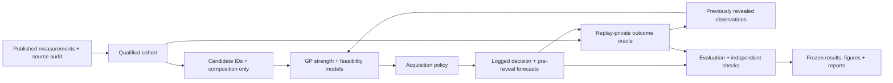
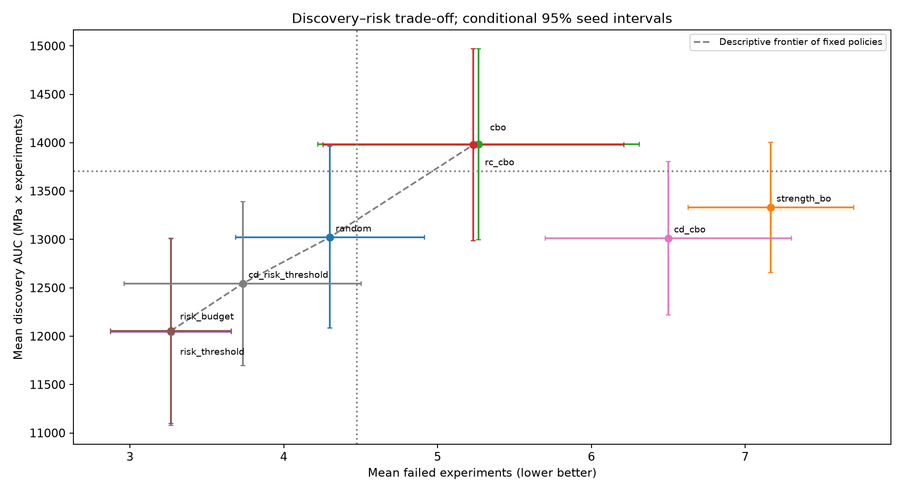

# AlloyGuard-BO

**A reproducible retrospective benchmark of high-strength alloy selection under a tensile ductility constraint.** The v1/v2 experiment is closed. This repository reports negative findings and a quantified discovery–failure trade-off—not a new state-of-the-art algorithm or a demonstrated improvement over existing research.

- **Ordinary constrained Bayesian optimization (CBO) achieved the highest mean discovery AUC.** Its advantage over random sampling was uncertain.
- **Reliability calibration did not produce a confirmed improvement.** No v2 policy met both prespecified goals: ≥15% fewer failed experiments and ≥98% of CBO discovery AUC.
- **Binary risk-aware policies reduced failures by approximately 38%, but sacrificed approximately 14% of discovery AUC.** Their cost-sensitive break-even point against CBO is approximately **965–971 AUC utility units per avoided failure**, with substantial uncertainty. These are preference units, not money.

[Scientific decision report](results/decision_review/DECISION_REPORT.md) · [v1 report](results/citrine/REPORT.md) · [v2 report](results/v2/REPORT.md) · [Reproduction](docs/publication/REPRODUCIBILITY.md) · [Limitations](docs/publication/LIMITATIONS.md) · [Data rights and attribution](DATA_LICENSES.md)

## Problem and experimental evidence

Select the next measured alloy to maximize **yield strength (MPa)** while requiring **tensile elongation ≥10%**. A failed selection is a measured elongation below that constraint; it is not a synthesis failure, laboratory accident, or missing measurement. The study replays existing measurements: no new alloy or prospective experimental discovery is claimed.

The primary source is the published **Citrine MPEA master dataset**, Borg et al. (2020), *Expanded dataset of mechanical properties and observed phases of multi-principal element alloys*, Scientific Data, [DOI:10.1038/s41597-020-00768-9](https://doi.org/10.1038/s41597-020-00768-9), from [CitrineInformatics/MPEA_dataset](https://github.com/CitrineInformatics/MPEA_dataset) at commit `d31e2510cccc3fb9e79d43ad62652f64ef8c2c5e`.

The 1,545-row master—not a substitute concatenation—was cross-checked against the original 2018/2019 records and bibliography. Explicit tensile mode, explicit **25°C**, paired numerical yield strength/elongation, valid composition and documented processing recipe produce **80 unique reported composition–recipe cases: 58 feasible and 22 infeasible**, covering **36 studies, 68 chemistries and 31 connected study-or-chemistry groups**. Ambiguous repeated recipes are excluded wholesale, not averaged into independent trials. [Source hashes](results/citrine/source_manifest.json), [qualification audit](results/citrine/data_audit.json), [all record exclusions](results/citrine/record_audit.csv), and [qualified cohort](results/citrine/cohort.csv) are included.

Only atomic composition fractions are primary predictors. Measured phases, grain size, hardness, UTS, elongation and yield strength are never candidate inputs. A prespecified secondary ablation adds known processing-recipe indicators. Source qualification does not imply complete control of strain rate, heat treatment or laboratory measurement error.

## Methods and architecture

v1 compares uniform **random selection**, **standard BO** (strength expected improvement), **ordinary CBO** (expected improvement × feasibility probability), and **reliability-calibrated CBO** (the same acquisition with observed-only grouped out-of-fold temperature calibration when support permits).

The strength surrogate is a Matérn-5/2 Gaussian-process regression model with observed-only scaling and an assumed 25 MPa observation-noise scale. Latent uncertainty drives expected improvement; observation uncertainty is logged for predictive diagnostics. Feasibility uses a binary Gaussian-process classifier with Laplace approximation. Kernel fitting, scaling and calibration use only previously revealed observations. A product acquisition approximates strength/feasibility dependence; it is not a validated joint physical model.

v2 adds **risk-threshold CBO** (minimum predicted feasibility .75), **risk-budget BO** (3.75 predicted failures allocated over 15 queries), **continuous-ductility CBO** (a GP for log1p elongation), and **continuous ductility plus the same risk threshold**. The continuous model obtains feasibility probability from its observation predictive distribution. Risk policies use a documented minimum-risk fallback when no candidate meets the rule. Expenditure uses the pre-reveal prediction, never the realized failure. Risk settings and noise assumptions were fixed before comparisons; no final-outcome tuning was performed. Neither risk method guarantees a hard bound on actual failures.



The policy receives neither the hidden outcome table nor the oracle. Typed candidates contain IDs, composition and grouping metadata; only observed outcomes enter fitting. This protects against accidental leakage, not malicious Python introspection. Repeated study/chemistry groups remain together in calibration folds and grouped stress-test partitions. The primary finite-pool replay is **not** a group-disjoint external test set.

## Actual results

Thirty matched seeds, **12 initial observations + 15 additional queries**, same candidate pool and budgets. Discovery AUC is the trapezoidal integral of best confirmed feasible yield strength over steps **0–15**, including the initial incumbent; units are **MPa × experiment steps**. Failure counts below exclude initialization. All methods are evaluated using real published outcomes.

| Policy | Mean discovery AUC | Mean failures / 15 | Mean best feasible strength at 15 (MPa) |
|---|---:|---:|---:|
| Random | 13,023.16 | 4.30 | 934.80 |
| Standard BO | 13,332.68 | 7.17 | 967.37 |
| **Ordinary CBO** | **13,985.57** | 5.27 | **1,017.93** |
| Reliability-calibrated CBO | 13,978.82 | 5.23 | 1,005.83 |
| Risk-threshold CBO | 12,043.20 | 3.27 | 815.43 |
| Risk-budget BO | 12,055.10 | 3.27 | 815.43 |
| Continuous-ductility CBO | 13,013.30 | 6.50 | 937.47 |
| Continuous + risk threshold | 12,544.49 | 3.73 | 858.93 |

[Machine-readable means and intervals](results/v2/summary.csv) · [All paired policy differences](results/decision_review/all_paired_differences.csv) · [Separate v2 verdicts](results/v2/verdicts.json)

Calibrated-minus-ordinary CBO AUC is **−6.75**, paired 95% interval **[−52.61, 39.11]**. Risk-budget-minus-CBO is **−1,930.47 AUC [−2,777.88, −1,083.07]** and **−2.00 failures [−2.92, −1.08]**. CBO-minus-random AUC is **+962.41 [−101.30, 2,026.12]**. These unadjusted intervals describe variability across matched replay initializations on one dataset—not uncertainty across independently sampled materials or new datasets.



The risk policies mostly invoke fallback (441/450 and 442/450 queries), are not meaningfully distinguishable, and buy fewer failures at appreciable discovery cost. Continuous modeling worsens Brier/log loss on exactly the same CBO histories and queried cases; its nominal 95% ductility intervals cover only 78.4% of CD-CBO selections. Extra response information alone did not produce better decisions.

For the post hoc utility **U = AUC − λ × failed experiments**, λ is an externally defined preference, not a test-optimized parameter or monetary exchange rate. Break-even against CBO is **971.19** for risk-threshold (Fieller 95% set **[522.99, 1,841.66]**) and **965.24** for risk-budget (**[522.86, 1,824.52]**). The [decision report](results/decision_review/DECISION_REPORT.md) includes all-policy trade-offs, utility curves, paired intervals and 5/10/15-query **prefix** sensitivity; those prefixes are not newly optimized shorter campaigns.

## Reproduce from a clean clone

Tested with **Python 3.12.14** on Linux CPU; use the unchanged exact dependency lock. No GPU, service credentials or external model API is needed. Input data needed by the completed tensile benchmark are committed. Historical audit tests also use the previously uploaded root workbooks; their separate provenance limitations are recorded in [DATA_LICENSES.md](DATA_LICENSES.md).

```bash
git clone https://github.com/jarettpoliner/AlloyGuard-BO.git
cd AlloyGuard-BO
python3.12 -m venv .venv
.venv/bin/python -m pip install -r requirements.lock
export PYTHONPATH="$PWD/src"
export OMP_NUM_THREADS=1 OPENBLAS_NUM_THREADS=1 MKL_NUM_THREADS=1
export MPLCONFIGDIR="$PWD/.matplotlib-cache"
.venv/bin/python scripts/prepare_publication_inputs.py
.venv/bin/python -m pytest -q

# Both full primary comparisons, all v2 sensitivity/grouped scenarios,
# and independent equality checks; choose an unused output directory.
bash scripts/reproduce_publication.sh .local-reproduction/run1
```

**124 original tests** cover unit/integration behavior, numerical EI/probabilities, synthetic correctness, single-class/cold starts, grouped calibration, risk tracking, hidden-label isolation and frozen integrity. The publication check independently verifies provenance, saved outcomes/curves/metrics, documented numbers and fresh reproduction. See [verification evidence](results/publication/verification.json) and [reproduction instructions](docs/publication/REPRODUCIBILITY.md). Replays are deterministic with pinned dependencies and one numerical thread; measured runtime and figure metadata are not scientific outputs.

## Repository guide

| Location | Purpose |
|---|---|
| `src/alloyguard_strength/` | Shared observed-only strength/feasibility models and private outcome replay |
| `src/alloyguard_citrine/` | Published-dataset qualification and v1 adapter |
| `src/alloyguard_v2/` | Frozen risk/continuous extensions and replay |
| `configs/citrine/`, `configs/v2/` | Frozen scientific protocols and hashes |
| `data/citrine/`, `results/citrine/cohort.csv` | Original source files, attribution, qualified cases |
| `tests/`, `requirements.lock`, `pyproject.toml` | Original tests, exact dependencies, Python packaging |
| `results/citrine/`, `results/v2/` | Primary traces, summaries, diagnostics, sensitivities and PNG/PDF figures |
| `results/decision_review/` | Final scientific decision, utility analysis and uncertainty |
| `docs/publication/`, `results/publication/` | Final instructions and publication verification |
| `src/alloyguard/`, `results/primary/` | Preserved earlier GE hardness/ordinal-screening study; different targets |
| `results/strength_v3/` | Historical provisional Mendeley work; **not a newly launched v3** |

Original scientific source, tests, configurations, traces and reports remain frozen. Historical documentation is preserved, including the [pre-publication README](docs/archive/prepublication_README.md); historical blocked-status notes are superseded for the completed Citrine v1/v2 workstream. Use the publication reproduction wrapper above rather than old report-generation wrappers that rewrite their original output paths.

## Scientific scope and limitations

This is a **small, retrospective, already exposed finite pool**. There are 80 reported cases, not 80 proven independent experiments. Study/process dependence, uneven class balance, missing processing detail and literature noise constrain generalization. The 72.5% feasible rate makes a feasible initial incumbent almost certain; that incumbent accounts for 85% of CBO AUC if held unchanged. Seed replication does not add independent measurements. Possible overlap with earlier development data exists for 63 cases. Grouped stress tests do not create an independent dataset, and one exhausts its 15-case target pool.

No prospective validation, synthesis-success prediction, economic savings, hard safety control, universal CBO superiority or improvement over published state-of-the-art research is claimed. The useful result is a reproducible demonstration of decision trade-offs and negative findings. The current campaign is closed; any future study would need an independently justified hypothesis and independent evaluation data. [Detailed limitations](docs/publication/LIMITATIONS.md).

## License and citation

Original code retains the [MIT license](LICENSE). It does **not** relicense source datasets or upstream materials. Citrine materials retain their [upstream Apache 2.0 license](data/citrine/raw/UPSTREAM_LICENSE), provenance and attribution; transformed cohort files are explicitly identified as derivatives. See [DATA_LICENSES.md](DATA_LICENSES.md) and [NOTICE](NOTICE). Cite both this repository and Borg et al. (2020), using [CITATION.cff](CITATION.cff). The pre-existing steel upload has **unresolved redistribution provenance** and is not part of the v1/v2 scientific benchmark; it has been preserved, not newly licensed or duplicated for publication.
