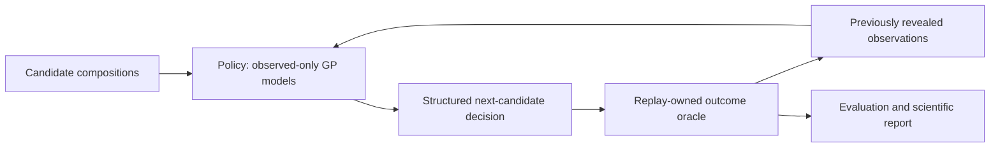

# AlloyGuard-BO

## Completed Citrine25°C tensile benchmark

**Verdict: NO_CONFIRMED_IMPROVEMENT from calibration.** The exact published `MPEA_dataset.csv` matches the official Citrine Git source. A conservative cohort contains **80 unique reported composition–recipe cases:58 feasible/22 infeasible**, from36 studies, with explicit tensile mode and25°C cross-checked against original rows. Ambiguous repeats remain preserved and excluded, not merged. This is an exploratory retrospective study, not independent prospective experiments.

| Policy | Mean discovery AUC(MPa·evaluations) | Elongation failures/15 |
|---|---:|---:|
| Random | 13,023.16 | 4.30 |
| Standard BO | 13,332.68 | 7.17 |
| Ordinary CBO | **13,985.57** | 5.27 |
| Calibrated CBO | 13,978.82 | 5.23 |

30 matched seeds,12 initial cases,15 additional selections,1,800 primary selections. Ordinary CBO had the highest observed mean. RC-minus-CBO AUC was **−6.75**, conditional paired95% interval **[−52.61,39.11]**. Calibration activated194/450 steps and changed25 acquisition winners, but no decision-quality improvement was established. CBO outperformed standard BO on this conditional metric, while its interval versus random spans zero. These seed intervals do not capture new-study/material uncertainty.

**95 tests passed.** The complete second30-seed run reproduced deterministic decisions/forecasts/non-timing metrics. An independent computation audited all1,800 primary outcomes and grouped calibration, plus900 heldout shift decisions. Known-recipe and initialization ablations completed. Original GE/Mendeley source, dependency locks and prior results remain unchanged.

[Scientific report and five PNG/PDF figures](results/citrine/REPORT.md) · [Reproduction instructions](docs/CITRINE_REPRODUCIBILITY.md) · [Frozen protocol](configs/citrine/frozen.yaml) · [Source manifest](results/citrine/source_manifest.json) · [Independent audit](results/citrine/independent_audit.json)

```bash
# Existing prepared environment; choose a new output directory
bash scripts/reproduce_citrine.sh results/citrine/reproduced_fresh
```

The official source master is primary; raw2018/2019 files are cross-checks, not substitutes. No post-experiment properties are predictive inputs. Primary features are composition only; a predeclared ablation adds recorded planned recipe indicators. There are possible matches between63/80 cases and earlier Mendeley software inputs, so this is **not a pristine external-validation set**; every replay still refits only its own revealed observations, and no final Citrine results tuned the methods. See the report's source, independence, process-heterogeneity and calibration limitations. The next step is an independently heldout, processing-resolved prospective test—not tuning on these final seeds.

The following Mendeley qualification notes and GE results are preserved as independent historical studies. The completed current primary comparison is the Citrine benchmark above.

## Strength/elongation continuation — executable pipeline, G1b pending

**G1a provenance is complete:** Mendeley v1, DOI [10.17632/4d4kpfwpf6.1](https://doi.org/10.17632/4d4kpfwpf6.1), CC BY 4.0, associated Chemical Data Collections paper [10.1016/j.cdc.2023.101068](https://doi.org/10.1016/j.cdc.2023.101068), independently verified by the user. **G1b remains separate:** case-level test-condition evidence is source-access blocked. Eight priority citations cover 123/457 numeric pairs; no indiscriminate review of all 135 is required.

A separate MPa/elongation GP/calibration/four-policy/hidden-oracle pipeline is implemented and tested: **72 tests passed**, deterministic five-seed provisional software replay reproduced, and five explicitly provisional plot types generated. No final scientific protocol is frozen or primary efficacy comparison run. Primary verified cases: 0 established; provisional rows: 453 with uncertainty flags; four unresolved identity records preserved separately. This does not assert no usable cohort exists in the literature.

See [current continuation report](results/strength_v3/REPORT.md), [workflow/reproduction instructions](docs/STRENGTH_V3.md), [priority sources](results/strength_v3/priority_studies.csv), [record audit](results/strength_v3/record_qualification.csv), and [recorded provenance](data/additional/mpea_official_provenance_v3.json). Apply saved source-access settings or provide prioritized methods/table evidence to resolve G1b; no new dataset-level provenance request is needed. The earlier [v2 qualification audit](results/dataset_qualification/REPORT.md) is preserved as historical evidence.

The completed GE benchmark below is unchanged and remains an independent hardness/ordinal-screening study. Its results do not validate the proposed tensile-strength/elongation benchmark.

A CPU-runnable retrospective test of whether feasibility modeling and probability calibration improve experimental alloy selection. A hard alloy can fail a mechanical screen; the policy maximizes measured hardness while accounting for the probability of ordinal ductility rank >=3.

**Verdict: INCONCLUSIVE for calibration efficacy.** The verified dataset contains 82 unique compositions but only seven feasible groups. The prespecified support gate disables calibration, so RC-CBO equals ordinary CBO exactly. Feasibility modeling reduced screening failures but underperformed hardness-only BO on the primary discovery-AUC metric. No favorable result was assumed or manufactured.

| Policy | Mean discovery AUC (GPa·evaluations) | Infeasible selections /15 | Best feasible @15 (GPa) |
|---|---:|---:|---:|
| Random | 49.984 | 14.10 | 3.699 |
| Hardness-only BO | 64.406 | 13.10 | 4.536 |
| Ordinary CBO | 61.703 | 12.43 | 4.544 |
| RC-CBO, calibration gated off | 61.703 | 12.43 | 4.544 |

30 matched seeds, 12 initial compositions, 15 additional selections per policy; 1,800 primary selections. CBO minus hardness-only AUC: **−2.703**, paired seed-level 95% interval **[−4.859, −0.546]**. Failure-count difference: **−0.667 [−0.982, −0.351]**. These intervals condition on this shared finite dataset, not independent physical experiments. RC-CBO minus CBO is exactly zero because calibration did not activate; that is not a negative test of active calibration.


All five scientific figures (PNG/PDF), calibration/forecast diagnostics, failure analysis, ablations and limitations are in [the report](results/REPORT.md). [Independent audit](results/independent_audit.json) recomputes outcomes/AUC from original measurements and checks every pre-selection observed-ID set.

## Model and evidence boundaries

Nine atomic-fraction inputs feed observed-only Matérn-5/2 hardness GP regression and Laplace feasibility GP classification. Ordinary CBO uses latent-hardness EI·p_raw; RC-CBO uses EI·p_cal from regularized observed-group out-of-fold temperature scaling when support permits. Hardness-only uses EI; random uses uniform seeded choice. Constrained policies share deterministic feasibility-discovery behavior before a feasible incumbent exists. Full hyperparameters, assumed observation noise, independence approximation and fallback behavior are in [SCIENTIFIC_METHOD.md](docs/SCIENTIFIC_METHOD.md).



The policy never receives the hidden outcome dataframe or an oracle reference. Typed immutable candidates contain only ID and composition. The boundary protects against accidental leakage, not malicious introspection in Python.

## Dataset and provenance

Detor et al. (2022), *Refractory high entropy alloy dataset with room temperature ductility screening*, Data in Brief 45, 108582. [Paper](https://doi.org/10.1016/j.dib.2022.108582); [Figshare v1](https://doi.org/10.6084/m9.figshare.17032760.v1), file 31504751. Original size **4,706 bytes**, MD5 **2a829ae75f620735b874b73fe69bf4d5**; SHA-256 **a9f2b7aaf4b7305535c321bf1354115ac0c157ef1159b23829dff850212ceacd**. License **CC BY 4.0 as supplied by the user from the official record**; publisher metadata/license were not independently fetched. Byte integrity and actual schema were verified locally. [Manifest](data/source_manifest.json), [audit](results/data_audit.md), [data card](docs/DATA_CARD.md).

86 raw records reduce to 82 exact composition groups. Mean replicate hardness, minimum replicate ordinal rank; no split replicates, imputation or threshold tuning. Solidus is a computational Thermo-Calc estimate, not a hardness measurement or a primary constraint. Raw/processed data are retained locally and ignored by Git; raw input must be supplied on a fresh clone, or acquired from the official URL. The original user upload may be at repository root.

## Reproduce

Use Python 3.12.14 (tested; project supports >=3.11). Keep the existing checkout; each cloud task is already isolated, so no worktree is needed. From repository root, ensure the original CSV is at `data/raw/GE_RefractoryAlloyScreeningDataset_FINAL.csv`. If the user-uploaded version is at root, copy it unchanged into that directory before setup. Otherwise the checksum-controlled helper can acquire the official file when network settings permit. A verified local file is always preferred.

```bash
bash scripts/setup_environment.sh
export PYTHONPATH="$PWD/src"
export OMP_NUM_THREADS=1 OPENBLAS_NUM_THREADS=1 MKL_NUM_THREADS=1
export MPLCONFIGDIR="$PWD/.matplotlib-cache"
export XDG_CACHE_HOME="$PWD/.cache"
.venv/bin/python scripts/acquire_identified_data.py
.venv/bin/python scripts/audit_data.py
.venv/bin/python -m pytest -q
.venv/bin/python scripts/verify_synthetic.py
```

Complete deterministic reproduction of the frozen 30-seed primary experiment, both exploratory initialization sensitivities, chemistry-shift support audit, independent result comparison and figure/report generation:

```bash
bash scripts/reproduce.sh results/reproduced_primary_new
```

Output directories are never silently overwritten. Choose another unused path when rerunning. Deterministic decisions, forecasts, and all non-timing outcome metrics must match; wall times and PDF rendering metadata can vary. Dependencies stay pinned in the existing `requirements.lock`. Numerical threads are one, with no GPU or external API required.

Individual stages (choose new result directories when existing artifacts are present):

```bash
# Smoke: five seeds, four matched policies
.venv/bin/python scripts/run_benchmark.py --config configs/smoke.yaml --output results/smoke_new
# Full frozen comparison: 30 seeds
.venv/bin/python scripts/run_benchmark.py --config configs/benchmark_frozen.yaml --output results/primary_new
# Verify a regenerated primary run against the preserved original
.venv/bin/python scripts/audit_results.py --reproduced results/primary_new
# Post-primary sensitivities/OOD-support audit in an unused output prefix
.venv/bin/python scripts/run_diagnostics.py --output-prefix results/diagnostics_new
# Generate all figures and report from preserved original primary results
.venv/bin/python scripts/generate_report.py
```

For a new methodology, make a separately labeled configuration and result directory; do not edit `benchmark_frozen.yaml` or overwrite original primary artifacts. `scripts/freeze_protocol.py` was executed after tests/synthetic checks/one-seed/five-seed smoke and before the primary comparison; it refuses a second freeze of the same file. Fresh reproduction uses the already frozen configuration rather than refreezing. A self-contained report-generation run uses the retained primary, sensitivity and audit artifacts. Scripts refuse incomplete or mismatched frozen source/data.

## Validation and limits

Unit/integration suite, numerical probability/EI/noise tests, grouped calibration tests, hidden-label interface checks, deterministic synthetic and real replay, complete 30-seed regeneration, and independent raw-outcome recomputation. Full evidence is in [EXECUTION_LOG.md](docs/EXECUTION_LOG.md). Warnings/fallbacks are retained per fit; no optimizer failures occurred in the primary run.

This is a small, imbalanced, previously measured finite pool. Seed replays overlap, the observations are conditional on successful characterization, and no prospective experiment, synthesis-success model or newly discovered alloy is claimed. Ordinal rank is not tensile strain. No paired simulation/laboratory hardness exists; solidus cannot substitute. There is no superiority claim over Radical AI's proprietary system. Calibration software passes correctness tests but active calibration has not been validated on these experimental data.

The next study needs substantially more experimentally feasible compositions with an outcome-blind prospective protocol; a true simulation-discrepancy extension additionally requires paired simulation and laboratory hardness/process metadata. [Model card](docs/MODEL_CARD.md), [references](docs/REFERENCES.md), [citation](CITATION.cff). Code retains the original MIT license; dataset attribution/licensing are separate.
