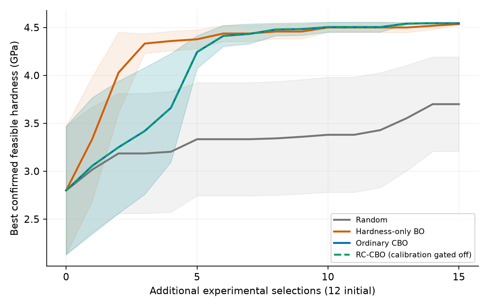
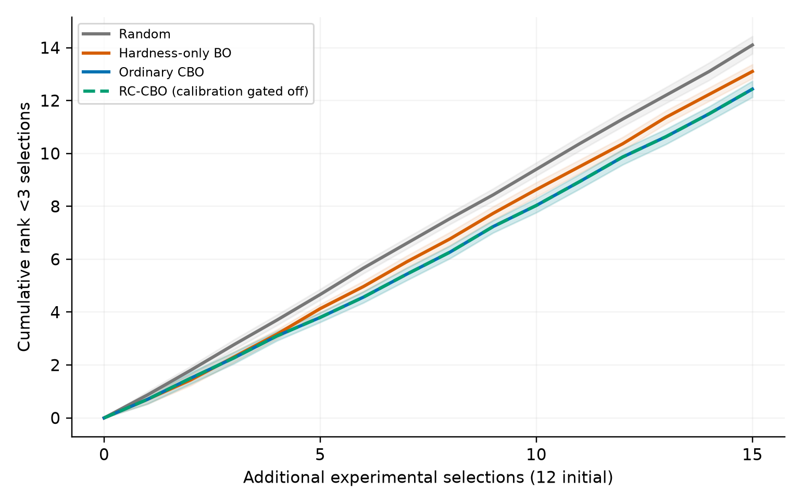
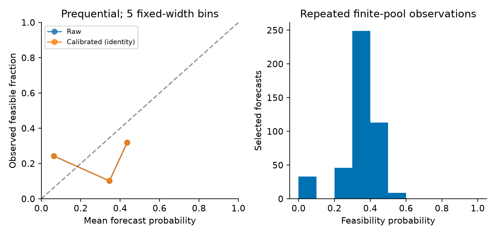
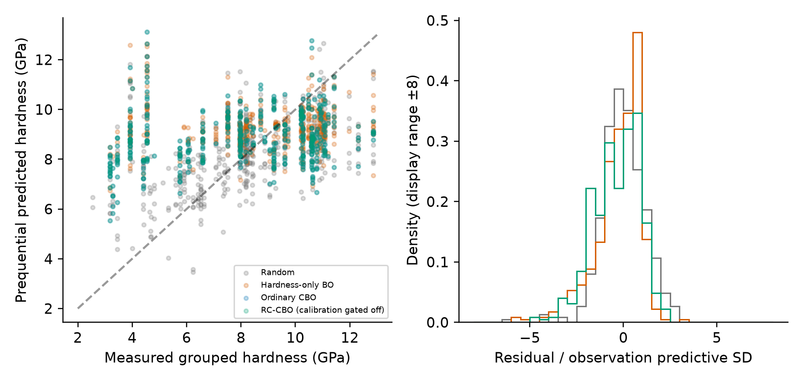
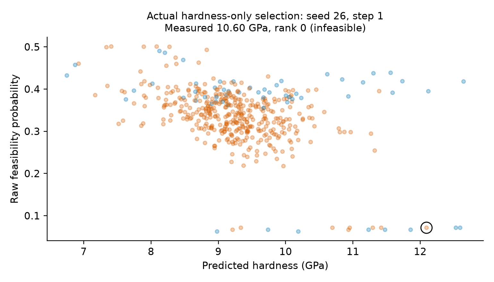

# AlloyGuard-BO: retrospective experimental selection study

## Abstract

**Research verdict: INCONCLUSIVE for the calibration hypothesis.** We evaluated random selection, hardness-only BO, ordinary constrained BO and RC-CBO using 86 experimental records grouped into 82 unique compositions. Only seven groups meet the frozen ordinal ductility-rank threshold >=3. This fails the predeclared 15-per-class support gate, so the real-data calibration procedure is disabled. RC-CBO and CBO consequently produce identical decisions for every seed; this is not evidence that temperature scaling cannot help a better-supported dataset. The full comparison ran 30 matched seeds, 12 initial compositions and 15 additional selections per policy (1800 selections).

## Scientific motivation

A hard alloy can fail a mechanical screening requirement. Constrained expected improvement follows Gardner et al. (2014) and Gelbart et al. (2014). Calibration is motivated by Deshpande et al. (2024), but our temperature scaling is not their exact procedure and carries no conformal or online coverage guarantee. This project tests a decision policy, not Radical AI's proprietary architecture. Its public narratives motivate the question; no independently verified claim about Radical's internal performance is made. Vela et al. (2023) addresses Bayesian modeling of refractory-alloy yield strength, a distinct target.

## Dataset and provenance

Detor, Oppenheimer, Casey and Crawford (2022), Data in Brief 45, 108582. Official dataset DOI: https://doi.org/10.6084/m9.figshare.17032760.v1, article 17032760, file 31504751, `GE_RefractoryAlloyScreeningDataset_FINAL.csv`. Local size 4,706 bytes and MD5 `2a829ae75f620735b874b73fe69bf4d5` match the user-supplied official identifiers. SHA-256: `a9f2b7aaf4b7305535c321bf1354115ac0c157ef1159b23829dff850212ceacd`. The user reports CC BY 4.0; official publisher metadata and license could not be independently fetched under the environment's network restriction. This provenance qualification is retained. After the bytes matched, no further dataset download was attempted. Source and processing manifests retain this distinction.

Nine atomic-percent columns are divided by 100 without renormalization; the maximum sum error is 1e-08 at%, below 1e-6 at%. All measurements are present, finite, and in expected ranges. Hardness is in GPa, solidus in °C, and ductility is an ordinal 0–5 screening rank, not tensile elongation. Two composition groups have three replicates each. We use arithmetic mean hardness and minimum rank, conservatively requiring all replicates to pass; original ranks and replicate spread remain recorded. The 4/4/5 replicate group is feasible under any minimum/median rule. No duplicate groups cross policy observations and hidden pools. Grouped class counts: 7 feasible and 75 infeasible. Maximum feasible measured group hardness is 4.5442369 GPa. Solidus is computational Thermo-Calc metadata and is excluded from the primary features and constraints.

## Methods

Composition-only features; StandardScaler fitted only to each current observed training set. Hardness uses a constant-amplitude Matérn-5/2 GP, initial length 2, length bounds [0.3,6], signal variance bounds [0.1,10], deterministic L-BFGS-B with max 60 iterations and no restarts. Targets are centered/scaled on observations only, scale floor 0.5 GPa. Fixed observational SD is 0.15 GPa, an explicit modeling assumption rather than a replicate-derived universal noise law. Training noise enters `alpha`; candidate EI uses latent posterior SD. Future observation intervals and NLL add 0.15² to latent variance. These are approximate 95% Gaussian intervals, not certified coverage.

Feasibility uses Laplace Gaussian-process classification with fixed unit-amplitude Matérn-5/2 length 2 and max 100 predictive iterations. Imbalance is preserved; no oversampling or class weighting distorts probabilities. With one observed class, the model returns a Beta(1,1)-smoothed empirical prior `(positive+1)/(n+2)` and logs the fallback. Numerical failures have a separate diagnostic fallback.

Temperature scaling fits log(T) on three-fold StratifiedGroupKFold predictions generated using current observations only, regularization 0.05·log(T)², bounds T in [1/3,3], at least 20 observations and at least five of each class. Every fold refits preprocessing and GP on its training groups. The dataset-level support gate requires 15 of each class; here it disables calibration globally and logs `CALIBRATION_INSUFFICIENT_DATA` with `DATASET_CLASS_SUPPORT_GATE`. This audit-derived gate is the only full-dataset label summary given to policy configuration; no individual hidden outcomes or labels enter policy fitting, selection or calibration. It prevents an unsupported calibration comparison rather than optimizing performance.

Ordinary CBO uses EI·p_raw; RC uses EI·p_cal. These products are a conditional-factorization approximation: hardness and feasibility may remain dependent. Hardness-only BO uses EI relative to the best observed hardness. Constrained EI uses the best observed feasible hardness. Without any feasible incumbent, both constrained policies score probability plus 0.05·minimum raw-composition distance/sqrt(2); EI is zero and no undefined incumbent is used. Candidates are exhaustively scored, with stable ID-order ties. Random selection is uniform seeded; fitted forecasts are logged for evaluation but do not affect random selection.

## Frozen experimental protocol and leakage controls

For each seed 0–29, uniform initialization without outcomes chooses 12 unique groups shared across all four policies. Each policy then reveals only its own 15 selected outcomes. Immutable typed candidates contain only ID and composition; observations contain only revealed outcomes. The replay engine owns the private oracle and never passes it or a hidden dataframe to policies. This is an architectural access boundary against accidental leakage, not a security sandbox for adversarial Python code. Tests check target invariance, duplicate exclusion, grouped cross-fitting and deterministic replay.

Software tests, synthetic checks, one-seed replay and five-seed smoke were completed before freezing `configs/benchmark_frozen.yaml`. Config hash: `fe5fe4829880e29676d481143fbb12b106b2326839a3fa7802f776f7ae36a94d`; source hash: `c55d6ea7627663d2663772b6cca5f5d5bbe4f0dd5024ca395e2272fb79d9d9d3`. No final-comparison results were used to alter policies. The primary score is trapezoidal area over steps 0–15 of the best observed feasible-hardness curve, including the shared initialization at step zero, and zero GPa until a feasible alloy exists. Failed-selection counts exclude initialization. Time to first feasible is zero if initialization has a feasible alloy; runs without one by budget are explicitly censored.

## Results

Means over matched replay seeds; failure counts are out of 15 additional selections.

| Policy | AUC (GPa·eval) | Best @5 (GPa) | Best @10 | Best @15 | Failures | Brier | Hardness MAE (GPa) |
|---|---:|---:|---:|---:|---:|---:|---:|
| Random | 49.984 | 3.334 | 3.380 | 3.699 | 14.10 | 0.1201 | 1.513 |
| Hardness-only BO | 64.406 | 4.377 | 4.500 | 4.536 | 13.10 | 0.1559 | 1.962 |
| Ordinary CBO | 61.703 | 4.243 | 4.504 | 4.544 | 12.43 | 0.1757 | 2.259 |
| RC-CBO (calibration gated off) | 61.703 | 4.243 | 4.504 | 4.544 | 12.43 | 0.1757 | 2.259 |

Paired AUC differences (left minus right):

- cbo_minus_hardness_bo: -2.703 GPa·evaluations; paired 95% interval [-4.859, -0.546].
- cbo_minus_random: 11.719 GPa·evaluations; paired 95% interval [5.252, 18.187].
- rc_cbo_minus_cbo: 0.000 GPa·evaluations; paired 95% interval [0.000, 0.000].
- rc_cbo_minus_hardness_bo: -2.703 GPa·evaluations; paired 95% interval [-4.859, -0.546].

Intervals are t intervals over randomized seed-level paired differences, conditional on this fixed finite dataset and policy configuration. Replays overlap in compositions and are not independent laboratory experiments. These intervals do not capture uncertainty across new alloy domains or prospective campaigns. Brier/log loss and hardness errors are prequential on adaptively selected observations; their evaluation populations differ across policies. They are not common test-set scores.

Figure 1. Mean best confirmed feasible hardness versus additional selections; shading is a conditional seed-mean 95% t interval. RC and CBO overlap exactly. Zero indicates no observed feasible alloy.

Figure 2. Cumulative rank <3 selections, excluding initialization. These are screening failures, not synthesis failures.

Figure 3. Selected prequential RC forecasts in five fixed-width bins. Raw and calibrated probabilities coincide because calibration is gated off. Repeated alloys/seeds and sparse positives make this descriptive; a reliability curve does not establish out-of-distribution reliability.

Figure 4. Pre-reveal hardness forecasts versus grouped measured hardness and residuals standardized by future-observation SD. The histogram displays residuals within ±8; NLL/coverage metrics include all records. Intervals are model assumptions, not calibrated mechanical guarantees.

Figure 5. Actual hardness-only selections; orange points fail rank >=3, blue pass. A highlighted case, if present, meets descriptive criteria predicted hardness >=8 GPa and feasibility <0.35 and was nevertheless selected by hardness-only EI. This example was selected after evaluation to illustrate a failure, never to tune the policy.

## Ablations, sensitivity and chemistry shift

Feasibility's contribution is the CBO-minus-hardness comparison above. The calibration ablation has exactly zero effect: all 450 CBO/RC query pairs match, there are zero calibration activations, and zero ranking changes. A monotone temperature transform could change the ranking of EI·p despite preserving discrimination; that mechanism is not exercised by these data.

- Initial n=8, cbo: mean AUC 47.587, failures 12.40 (5 exploratory seeds).
- Initial n=8, hardness_bo: mean AUC 61.689, failures 13.20 (5 exploratory seeds).
- Initial n=8, random: mean AUC 41.806, failures 13.80 (5 exploratory seeds).
- Initial n=8, rc_cbo: mean AUC 47.587, failures 12.40 (5 exploratory seeds).
- Initial n=16, cbo: mean AUC 62.286, failures 11.40 (5 exploratory seeds).
- Initial n=16, hardness_bo: mean AUC 64.280, failures 12.40 (5 exploratory seeds).
- Initial n=16, random: mean AUC 38.623, failures 14.20 (5 exploratory seeds).
- Initial n=16, rc_cbo: mean AUC 62.286, failures 11.40 (5 exploratory seeds).

Sensitivity runs are explicitly exploratory and use separately recorded configurations/seeds with equal budgets at each initial size; raw AUC across initial sizes is not a matched-budget causal comparison because initialization also consumes laboratory measurements. They do not select a winning initialization.

Chemistry-shift status: **OOD_TEST_INSUFFICIENT_SUPPORT**. Three KMeans groups are defined using only unscaled composition fractions with seed 0, n_init=10. The predeclared meaningful-support requirement is at least four feasible groups in training and four in the held-out family, plus 15 target groups. Only seven feasible groups exist globally, so no split supports both requirements. Composition cluster counts are recorded, but no OOD calibration result is manufactured.

## Failure analysis and diagnostics

Real-data calibration cannot be estimated with the required support. The feasibility classifier starts with a single class in some replays; smoothed-prior fallback counts: 162. Hardness optimizer non-successes: 0; logged warning messages: 35. Bound warnings mean small-sample fits favor a bound; finite prediction and acquisition checks remain enforced. Exact warning text and frequencies are in `model_diagnostics.json`, with every per-step fit retained in JSONL. Fits/warnings were not discarded to improve metrics. No failed fit is silently described as an ordinary fit.

Distance diagnostics label raw-composition nearest-neighbor distance >0.35 as distant from observations. This is a heuristic support diagnostic, not a validated extrapolation test. Predictive miscalibration and adaptive selection can produce poor EI decisions even when numerics are correct. A policy can successfully identify the very few feasible alloys yet be unsuitable for predicting arbitrary ductile compositions.

## Reproducibility

Python 3.12.14 on Linux; CPU numerical threads are fixed to one. Exact installed versions are in `requirements.lock` (hash `f5ea917bffc828771f41f5c87a526aaefd95cba1d5cb62646ac172ca9a271a0a`). From repository root, follow README's commands for local data validation, audit, tests, synthetic checks, smoke, freeze, primary replay and reporting. `scripts/reproduce.sh` writes regenerated runs under a new directory and verifies frozen methodology/data hashes rather than overwriting original results. Source, processed dataset, configuration and output hashes are in `results/primary/benchmark_manifest.json`. Timing fields vary across executions; deterministic selections/outcome metrics are verified separately. Full run wall time: 12.4 seconds; fitting overhead is recorded per policy/seed.

## Limitations

The dataset is small and has only seven positive composition groups at the fixed threshold. Selection is among previously measured alloys; no new compositions or physical experiments were generated. Repeated seed replays are correlated through a shared finite pool. There is no prospective laboratory validation or paired simulated/laboratory hardness dataset. Ordinal ductility screening imperfectly represents mechanical reliability, and successfully synthesized/characterized materials do not represent all failed synthesis attempts. Aggregate replicate handling and assumed noise simplify the measurement process. Official license/provenance metadata were user-supplied rather than independently retrieved, though file integrity matches exactly. External references are attributed, but full article contents were not freshly consulted because network restrictions persist. No superiority over Radical AI's internal system, novel theoretical guarantee, or state-of-the-art result is claimed.

## Conclusion and next research step

This implementation produces a real-data, matched finite-pool decision comparison. It cannot establish the proposed calibration benefit: the scientifically justified support gate forces RC-CBO to ordinary CBO, with zero paired difference. The next step is a larger, composition-diverse set of experimental screening outcomes with substantially more feasible cases, collected with an outcome-blind prospective protocol. A true simulation-to-laboratory discrepancy extension additionally needs paired computational and laboratory hardness with process/microstructure metadata; solidus is not a substitute for that pairing.

## Additional quantitative interpretation

The evidence does not support the general claim that the implemented constrained policy improves discovery efficiency over hardness-only BO. CBO AUC was lower by -2.703 GPa·evaluations, with conditional paired 95% interval [-4.859, -0.546]. It did reduce infeasible selections by 0.667 per 15 selections; failure-count difference was -0.667 [-0.982, -0.351]. This is a tradeoff under the frozen metric, not an overall improvement. The primary metric favors hardness-only BO in this dataset/configuration. Both model-based policies substantially outperformed random on mean AUC, but the calibrated policy adds no effect because its calibration is disabled.

AUC includes the shared step-zero incumbent and rewards early feasible discoveries. Final feasible hardness alone can conceal delayed discovery. Paired seed intervals remain conditional finite-pool summaries, not universal physical performance claims or multiple-comparison-adjusted tests.

| Policy | P(feasible by 5) | By 10 | By 15 | Median first-feasible selection* | Censored at 15 | Log loss | Hardness NLL | Approx. 95% interval coverage | Fit time/run (s) |
|---|---:|---:|---:|---:|---:|---:|---:|---:|---:|
| cbo | 1.000 | 1.000 | 1.000 | 0.0 | 0 | 0.5473 | 2.521 | 0.887 | 0.102 |
| hardness_bo | 1.000 | 1.000 | 1.000 | 0.0 | 0 | 0.5077 | 2.465 | 0.891 | 0.101 |
| random | 0.833 | 0.833 | 0.900 | 0.0 | 3 | 0.4112 | 2.120 | 0.922 | 0.098 |
| rc_cbo | 1.000 | 1.000 | 1.000 | 0.0 | 0 | 0.5473 | 2.521 | 0.887 | 0.101 |

*First-feasible query is 0 if initial observations already contain a feasible group. Median is among uncensored runs, with censor counts shown; it is not a survival-model estimate. Full censored trajectories and per-budget probabilities are retained. Approximate Gaussian coverage below 0.95 indicates that these model intervals should not be advertised as calibrated uncertainty. NLL uses noisy-observation SD, not latent SD.

### Cold-start and actual failure analysis (posthoc descriptive)

Among the 8 seeds with no initially feasible alloy, mean CBO-minus-hardness AUC was -10.557. Among the 22 seeds with an initially feasible alloy it was 0.154. This associates most observed AUC loss with feasibility-discovery starts; it does not causally identify a better cold-start algorithm. The worst CBO-minus-hardness seed was 16, delta -19.543; all its selection traces are preserved. The prescribed 0.05 exploration coefficient was not retuned.

The Figure 5 case is seed 26, step 1, `alloy-3f825f09aa08b905`. Hardness-only forecast 12.094 GPa and feasibility 0.0714; the observed alloy had hardness 10.599 GPa and rank 0. The training set was single-class, so the low probability was a smoothed empirical-prior fallback rather than validated chemistry-specific discrimination. A posthoc one-step CBO decision from exactly those same revealed observations chose `alloy-e1d86f1ee424c23a`, whose actual rank was 1. It avoided that particular candidate but still selected an infeasible one. Thus the figure does not prove successful experimental risk avoidance. It illustrates both hardness-only disregard of feasibility and the limitations of sparse-feedback feasibility search. This counterfactual is a fixed-policy diagnostic, not the sequential CBO trajectory, and was never used for tuning.

Composition-support error summaries are in `posthoc_analysis.json`. They condition on adaptively selected forecasts and should not be read as a held-out generalization test.

## Final independent audit and gate status

The independent recomputation within this implementation session audited **1800 selections and 120 runs** against the raw laboratory outcomes. It verified source/config/output checksums, grouped truth, exact recorded pre-selection observed sets, no duplicate query, every AUC/failure count, matched initialization and gated-policy equality. The complete regenerated 30-seed run status is **FULL_30_SEED_EXACT_DECISIONS_AND_FORECASTS_MATCH**. This is not external peer review.

Final suite: **43 passed, 0 failed, 0 errors, 0 skipped**. The pre-freeze suite had 38 passing tests; additional post-comparison tests audit integration/artifacts without changing methodology. G1 is passed with the documented publisher-metadata/license verification qualification; G2–G8 are complete for this retrospective workflow. Calibration efficacy and OOD validation remain scientifically unsupported, explicitly disabled/unrun rather than passing scientific claims.
