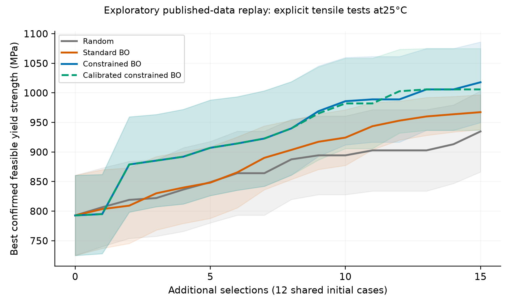
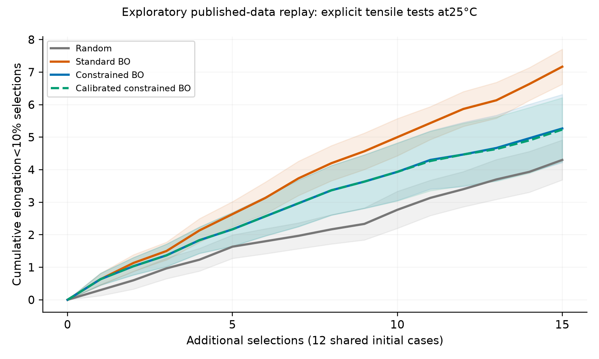
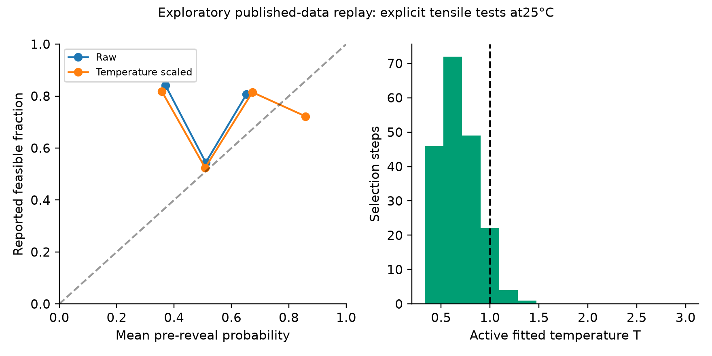
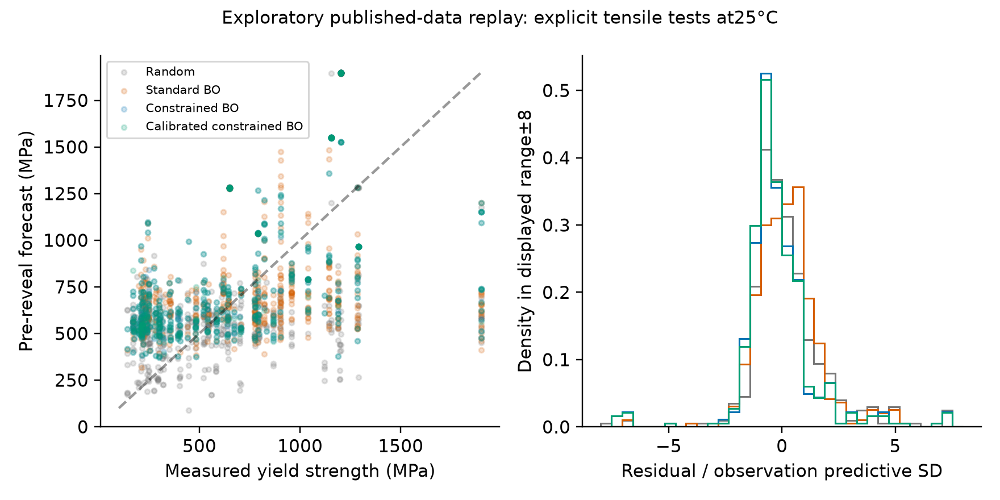
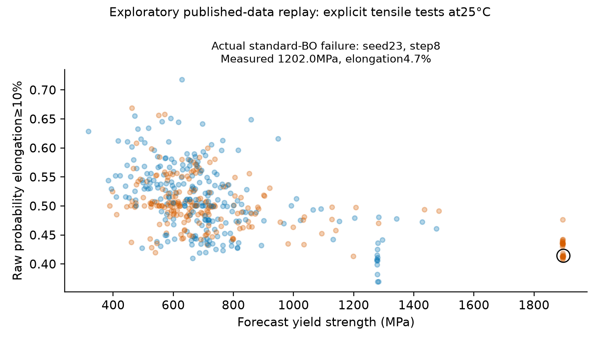

# AlloyGuard-BO Citrine 25°C tensile benchmark

## Abstract and research verdict

**NO_CONFIRMED_IMPROVEMENT.** This is an exploratory retrospective comparison on 80 conservative published case groups, 58 meeting tensile elongation≥10% and 22 below it, across 36 cited studies. Maximum mean primary discovery AUC was obtained by **Constrained BO**. RC-CBO minus ordinary CBO AUC was **-6.75 MPa·evaluations**, paired conditional 95% interval **[-52.61,39.11]**. A full 30-seed matched comparison executed 1,800 additional selections. It does not represent independent physical experiments or prospective discovery.

## Published source and integrity

Borg et al. (2020), *Expanded dataset of mechanical properties and observed phases of multi-principal element alloys*, Scientific Data, DOI10.1038/s41597-020-00768-9. Official repository https://github.com/CitrineInformatics/MPEA_dataset, pinned commit`d31e2510cccc3fb9e79d43ad62652f64ef8c2c5e`. All four supplied source-file Git blobs match upstream exactly. The official README identifies `MPEA_dataset.csv` as the complete master; `combined_data.csv` is not intended for wide consumption. Original 2018/2019 records and bibliography are cross-checks, never represented as an equivalent master dataset. Upstream repository LICENSE is Apache 2.0; full text retained separately from AlloyGuard's MIT code license and the separate Mendeley workbook's license. Upstream notebooks/scripts were inspected as text/JSON and never executed.

Master SHA-256:`c5504d93fd324d1be26cf814d0694ee9ee95578d68a0b38aba6813b939fa2c5d`. Cohort SHA-256:`9cdedf8fae3154c9d66b5654a961714e3c36fe1b3783610e38436216efa06724`. Full file sizes/Git blob/SHA-256 checks are in `source_manifest.json`.

## Scientific qualification and all exclusions

The master contains 1,545 rows. **246** explicitly report tensile modeT, temperature 25°C, numerical yield strength and elongation. Raw files confirm each row's temperature/test/reference correspondence; no missing temperature was assumed room temperature. Keep positive finite yield strength, nonnegative finite elongation, valid atomic-ratio formulas, explicit recorded processing recipes and study DOIs. Raw censor bounds cannot become exact target values. The final primary cohort contains**80 unique composition+recorded-recipe cases**, no duplicate candidate key even across studies; **58 feasible/22 infeasible**,36 cited studies, 68 chemistries and 31 source/chemistry-connected groups. These are independent reported-case groups for replay, not independently verified physical replications with every process variable controlled.

First exclusion-reason counts (mutually exclusive, sum with 80 cases to 1,545):`{'NOT_EXPLICIT_TENSILE': 1187, 'AMBIGUOUS_REPEATED_COMPOSITION_RECIPE': 159, 'MISSING_NUMERIC_TARGET_PAIR': 68, 'NOT_EXPLICIT_25_C': 44, 'MISSING_PROCESSING_RECIPE': 7}`. Every row, all overlapping reasons and source locator are retained in `record_audit.csv`. All ambiguous repeated composition/recipe groups are quarantined intact; none is averaged into a fictitious material state. Detailed source processing may conceal different anneals/working conditions despite identical recipe labels; a curator's raw note explicitly warns about this. The source also collapses detailed sequences into broad CAST/WROUGHT/etc classes. The adapter uses raw recorded recipe sequences only for case identity, retaining both versions as metadata.

All 80 retained compositions match the upstream documented normalization of original formulas, including parenthesis parsing and rounding ratios to three decimals. Atomic fractions are computed from the published atomic-ratio formulas. This reproduces the published representation; rounding/ambiguous nominal notation can limit chemical fidelity and no independent assay of composition is implied. Published means remain targets; retained ±source uncertainty strings remain recorded. Elongation above 100% is physically possible and is not rejected as physically invalid; such rows in the preliminary set are excluded only by ambiguous processing identity. No phases, grain size, measured hardness, UTS, other measured properties, density/modulus predictions or bibliography fields enter primary predictors.

## Methods: existing models, unchanged

Reused `alloyguard_strength` implementation: observed-only StandardScaler and target scaling (floor 50 MPa); Matérn 5/2 GPR with amplitude[0.1,10], length[0.3,6], initial amplitude 1,length 2, deterministic L-BFGS-B max 60 iterations; assumed observational SD 25 MPa. EI uses latent SD; observation intervals/NLL add 25². The noise is a modeling assumption, not an inferred universal experimental error. Feasibility: Matérn 5/2 Laplace GPC with fixed length 2, max 100 predictive iterations, single-class Beta(1,1) smoothed prior fallback. No artificial class rebalancing.

Primary features are composition only, matching the already implemented workflow. Known processing recipes define independent candidate cases; omitting their quantitative effects from primary regression is a deliberate model limitation. The predeclared processing-feature ablation adds one-hot recorded recipes to every policy equally, without measured-phase inputs. In that ablation the logged composition-feature tuple includes the explicitly documented recipe feature vector, and nearest-distance diagnostics are input-feature rather than purely chemical distances.

Calibration: currently observed data only, three-fold StratifiedGroupKFold by the transitive study-OR-chemistry component. Require≥20 observations,≥5 members/class,≥3 observed groups/class, both classes in every train/validation fold. Each fold refits observed-training scaling/classification. Fit positiveT∈[1/3,3] minimizing mean OOF log loss+0.05 log(T)²; otherwise identity with reason. Dataset-level support gate≥15 cases and≥3 groups/class is met. All fold IDs, warnings and statuses are logged. No hidden labels train the calibrator.

Policies: uniform seeded random, standard strength-only latent EI, CBO(EI·raw feasibility), RC-CBO(EI·calibrated feasibility). CBO/RC differ only by calibration given identical observations; after different actions each sees its own revealed history. Conditional outcome dependence makes EI·p a factorization approximation, not exact correlated-outcome constrained EI. No-feasible start uses p+0.05 normalized nearest-observed distance and no undefined incumbent. Full finite pool is exhaustively scored; ties follow stable IDs. Study provenance is grouping metadata, not a predictor. Typed candidates contain no target columns and never receive an oracle reference; this prevents accidental leakage, not adversarial Python introspection.

## Frozen protocol and validation

12 initial outcome-blind cases per seed, shared across all policies;15 extra evaluations; seeds 0–29; fixed elongation threshold 10%. Primary metric is trapezoidal area under best confirmed feasible-strength curve from step 0 to 15, including the shared initialized incumbent, with 0 MPa until a feasible case is observed. Failure counts exclude initialization. Tests, synthetic correctness, one-seed and five-seed smoke completed before freezing. No final results were used to revise cohort/threshold/models/protocol. Config hash`0d7938858f175c854f1555f88ba0dc983cdff22c505f00bba742d7db50de5011`; base model source`6abc50d8d407f504c864807c9ac8d263b5607f23bbfbcac6a96529e59ab5ffbd`; adapter source`00d34388d62cfe8408d90d843db74b90309557561ac10f5370b33f0b662f9c38`. Numerical threads fixed to one. Original GE and provisional Mendeley artifacts remain untouched.

## Actual primary results

Means over 30 matched seeds. AUC units MPa·evaluations; strengths MPa; failures out of 15.

| Policy | AUC | Best@5 | Best@10 | Best@15 | Failures | Brier | Strength MAE |
|---|---:|---:|---:|---:|---:|---:|---:|
| Random | 13023.16 | 848.99 | 894.36 | 934.80 | 4.30 | 0.2134 | 270.52 |
| Standard BO | 13332.68 | 848.20 | 924.37 | 967.37 | 7.17 | 0.2446 | 356.01 |
| Constrained BO | 13985.57 | 907.07 | 985.93 | 1017.93 | 5.27 | 0.2220 | 315.40 |
| Calibrated constrained BO | 13978.82 | 907.07 | 982.13 | 1005.83 | 5.23 | 0.2192 | 311.30 |

Paired differences:

- rc_cbo_minus_cbo: AUC difference -6.75 MPa·evaluations, 95% interval[-52.61,39.11]; failures difference -0.03[-0.24,0.17].
- cbo_minus_strength_bo: AUC difference 652.89 MPa·evaluations, 95% interval[73.84,1231.94]; failures difference -1.90[-3.07,-0.73].
- rc_cbo_minus_strength_bo: AUC difference 646.14 MPa·evaluations, 95% interval[60.57,1231.71]; failures difference -1.93[-3.04,-0.82].
- strength_bo_minus_random: AUC difference 309.52 MPa·evaluations, 95% interval[-442.66,1061.70]; failures difference 2.87[2.01,3.73].
- cbo_minus_random: AUC difference 962.41 MPa·evaluations, 95% interval[-101.30,2026.12]; failures difference 0.97[-0.21,2.15].

These t intervals summarize randomized seed variation **conditional on this fixed finite dataset/configuration**. Repeated replays share cases and are not independent laboratory experiments. They do not measure uncertainty across new materials/studies. No multiple-comparison correction or universal statistical-superiority claim is made. Selected-sample Brier/log loss/errors compare different adaptive populations across methods; they are not a common independent test set. Within RC's same 450 queried cases, raw Brier=0.2230, calibrated Brier=0.2192; this descriptive paired-forecast diagnostic alone cannot prove better decisions.

Figure 1. Mean best feasible strength, conditional 95% seed-mean t bands. Zero means no observed feasible case. No material was synthesized here.

Figure 2. Experimental-record elongation failures, not failed synthesis.

Figure 3. Pre-reveal RC raw/calibrated forecasts, five fixed-width bins, and active fitted temperatures. Bin counts in reliability_bins.csv. Repeated cases and adaptive selection make these descriptive; no iid calibration guarantee or conformal guarantee is claimed.

Figure 4. Predicted versus measured yield strength and residuals standardized by noisy-observation SD. Histogram displays±8; numerical NLL/coverage include all values. Gaussian intervals are approximate, not certified reliability.

Figure 5. Actual standard-BO selections colored by observed feasibility; highlighted case has the highest predicted strength among its failed selections. This posthoc illustration does not establish that constrained BO would necessarily avoid it.

## Calibration effects, ablations and failure analysis

RC acquisition winner differs before reveal from its raw-feasibility counterfactual at**25** steps. Calibration statuses:`{'CALIBRATION_INSUFFICIENT_DATA': 256, 'CALIBRATION_ACTIVE': 194}`. Across seed-level AUC, RC better than CBO:1; worse:3; equal:26. Worst RC-minus-CBO seed 16, AUC delta-342.00. The first action divergence, if any, both forecasts/actual outcomes, and actual high-strength failure example are retained in failure_analysis.json. No inconvenient outcomes or worse seeds are removed. Temperature scaling preserves raw probability ordering but can change EI·p ordering; sequential downstream effects are not the same as improving classification discrimination.

The primary CBO-versus-standard and RC-versus-CBO contrasts isolate feasibility and calibration contributions without weakening baselines. All planned extra runs are exploratory and use separate seed/config/run artifacts:

| Additional experiment | Policy | Mean AUC | Failures | Brier |
|---|---|---:|---:|---:|
| initial_16 | cbo | 14151.20 | 6.00 | 0.2281 |
| initial_16 | random | 13404.70 | 4.40 | 0.2074 |
| initial_16 | rc_cbo | 14033.60 | 5.60 | 0.2162 |
| initial_16 | strength_bo | 13629.00 | 6.80 | 0.2299 |
| initial_8 | cbo | 15645.90 | 7.00 | 0.2530 |
| initial_8 | random | 11437.20 | 3.00 | 0.2008 |
| initial_8 | rc_cbo | 15645.90 | 7.00 | 0.2535 |
| initial_8 | strength_bo | 13480.20 | 7.00 | 0.2416 |
| recipe_features | cbo | 14193.50 | 5.00 | 0.2373 |
| recipe_features | random | 12952.70 | 3.40 | 0.2187 |
| recipe_features | rc_cbo | 14193.50 | 5.00 | 0.2374 |
| recipe_features | strength_bo | 14435.60 | 5.40 | 0.2539 |
| study_chemistry_shift_0 | cbo | 14415.00 | 3.00 | 0.2072 |
| study_chemistry_shift_0 | random | 14415.00 | 1.40 | 0.1793 |
| study_chemistry_shift_0 | rc_cbo | 14415.00 | 3.00 | 0.1965 |
| study_chemistry_shift_0 | strength_bo | 14415.00 | 3.20 | 0.2130 |
| study_chemistry_shift_1 | cbo | 11430.66 | 5.00 | 0.2187 |
| study_chemistry_shift_1 | random | 11739.54 | 5.00 | 0.2211 |
| study_chemistry_shift_1 | rc_cbo | 11430.66 | 5.00 | 0.2107 |
| study_chemistry_shift_1 | strength_bo | 11920.14 | 5.00 | 0.2210 |
| study_chemistry_shift_2 | cbo | 11509.52 | 6.40 | 0.2453 |
| study_chemistry_shift_2 | random | 13418.88 | 6.00 | 0.2377 |
| study_chemistry_shift_2 | rc_cbo | 11509.52 | 6.60 | 0.2560 |
| study_chemistry_shift_2 | strength_bo | 12125.40 | 8.00 | 0.2477 |

Initial-size 8/16 runs use seeds 100–104 and 15 queries. They have different total measurement costs; they do not select an optimal initialization. Processing ablation uses known recipe one-hot vectors and the same models/policies. Study/chemistry shift uses three outcome-blind component splits, seeds 200–204,12 training-pool initial cases and 15 heldout queries where prespecified size/class support permits. Shift support/outcomes:`[{'fold': 0, 'status': 'COMPLETED', 'train': {'cases': 46, 'feasible': 28, 'infeasible': 18}, 'target': {'cases': 34, 'feasible': 30, 'infeasible': 4}, 'selections': 300}, {'fold': 1, 'status': 'COMPLETED', 'train': {'cases': 65, 'feasible': 48, 'infeasible': 17}, 'target': {'cases': 15, 'feasible': 10, 'infeasible': 5}, 'selections': 300}, {'fold': 2, 'status': 'COMPLETED', 'train': {'cases': 49, 'feasible': 40, 'infeasible': 9}, 'target': {'cases': 31, 'feasible': 18, 'infeasible': 13}, 'selections': 300}]`. No study or chemistry component crosses train/target pools. Its incumbent includes initial observed cases outside the target pool, so stronger initial materials can create a ceiling; this is not prospective proof of OOD robustness. No outcomes choose the split.

Optimizer non-successes:0. Logged warning events:867. Exact boundary-warning text, single-class fallback and calibration-activation/failure reasons are preserved per fit and in model_diagnostics.json. Conservative hyperparameter bounds were not changed to favor a result. Sparse labels, study dependence, unknown quantitative processing and composition-only misspecification can cause both uncertainty and selection failures even when fits are numerically valid.

## Reproducibility and independent audit

Test evidence:95 tests, 0 failures, 0 errors, 0 skipped. Audit status:PASSED. The audit recomputes grouped truth/incumbents/AUC/failures, verifies recorded observed-ID sets and group-disjoint calibration, hashes all primary outputs and checks a second complete frozen 30-seed run for deterministic decisions/forecasts/non-timing metrics. It is an independent computation within this session, not external peer review. See CITRINE_REPRODUCIBILITY.md and scripts/reproduce_citrine.sh. Exact locked dependencies unchanged; Python 3.12.14; source/license/input/output/config hashes retained. Times/rendering metadata can vary, scientific deterministic outputs cannot. Publication of cloud configuration is separate from local validation.

## Limits and next research step

80 selected published case groups are small and selection-biased after strict ambiguity exclusion. Only reported temperature/mode/recipe information is checked; strain rate, geometry, heat-treatment details and measurement extraction conventions remain heterogeneous. Master formulas have published rounding and nominal-notation limitations. Independent studies are connected through chemistry, and retrospective seeds share one pool. No prospective experiments, new-alloy synthesis, synthesis-failure prediction, physical safety certification, simulation-to-laboratory discrepancy fit or superiority over Radical AI's proprietary pipeline is claimed. No theoretical calibrated/conformal coverage guarantee follows from this temperature scaling.

The evidence supports further study of selection under mechanical constraints, with this exact conditional verdict; a stronger next step is a prospectively designed, composition/processing-resolved dataset with independently heldout studies, raw stress-strain definitions and repeated uncertainty measurements. Any benefit observed here needs independent replication; negative/inconclusive differences should remain reported rather than retuning on final seeds.

## Direct interpretation and predictive uncertainty

**Which policy was best?** Ordinary constrained BO had the highest mean primary discovery AUC in this frozen cohort. Relative to standard BO, its conditional paired AUC difference was+652.89 MPa·evaluations, 95% interval[73.84,1231.94], and it made 1.90 fewer elongation failures per 15 queries, interval[0.73,3.07] for the reduction. This is evidence of a useful feasibility-model contribution in this pool/configuration, not a universal materials-discovery improvement. Its AUC difference versus random has an interval spanning zero, so the highest observed mean does not establish superiority to every baseline.

**Did calibration help decisions?** RC-CBO minus CBO AUC was−6.75[−52.61,39.11]. The interval includes both directions, the mean is near zero, and no improvement is confirmed. It changed acquisition rankings 25 times and activated 194/450 steps; it was not simply disabled as in the original GE experiment. On the same RC selected cases, Brier declined from 0.222998(raw) to 0.219216(calibrated), but this did not translate into demonstrated better selection. Calibration's failure-count difference versus CBO was−0.033[−0.241,0.174], also inconclusive. These are conditional unadjusted exploratory intervals, not independent prospective experiments.

**What failed?** Standard BO pursued high-yield-strength but low-elongation cases, averaging 7.17 failures/15 versus 5.27 for CBO, 5.23 for RC-CBO and 4.30 for random. Constraints are probabilistic preferences, not hard safety filters; constrained methods can still fail more often than random while pursuing a stronger objective. Composition-only strength modeling ignores quantitative processing and other study differences. Its high prequential errors, sub-nominal interval coverage and frequent lower kernel-length bounds expose misspecification/sparse-data limitations. Random forecasts are evaluated on a less selectively difficult population, so their lower errors do not alone prove a better surrogate.

| Policy | Log loss | Strength NLL | Nominal 95% observation coverage | Feasible by 15 | Median first feasible query* | Censored | Mean fitting time/run(s) |
|---|---:|---:|---:|---:|---:|---:|---:|
| cbo | 0.6360 | 25.465 | 0.764 | 1.000 | 0.0 | 0 | 0.107 |
| random | 0.6185 | 13.580 | 0.816 | 1.000 | 0.0 | 0 | 0.111 |
| rc_cbo | 0.6295 | 24.419 | 0.773 | 1.000 | 0.0 | 0 | 0.158 |
| strength_bo | 0.6823 | 22.843 | 0.833 | 1.000 | 0.0 | 0 | 0.105 |

*Query 0 means initialization already contains a feasible case. Medians among uncensored runs are descriptive, not survival estimates. Coverage uses latent variance plus assumed 25 MPa observation noise and is not a calibrated guarantee.

There were 0 optimizer non-successes and 867 retained kernel-bound warning events. Of these, 852 concern the conservative 0.3 lower length bound and 15 the 6.0 upper bound. These indicate that marginal-likelihood optimization often preferred short-range or boundary covariance under composition-only small-data fits. Predictions/acquisitions remained finite. Bounds were not retuned after observing policy performance.

The first CBO/RC decision divergence occurred at seed 0, query 13, under the shared history up to that query. CBO chose`citrine-35a932c9bf44eb8f` with measured strength 1900.00 MPa, elongation 7.90%; RC chose`citrine-95fba8d80c4a59d5` with 482.00 MPa, 13.30%, usingT=0.601. This is a traceable posthoc example, not a rule chosen to favor calibration.

Figure 5's measured failure is`citrine-629bf58b4031345c` at seed 23, query 8: forecast 1897.78 MPa,p_raw=0.414; actual 1202.00 MPa and 4.70% elongation. It demonstrates a real selected screening failure; it does not prove another policy would avoid the same event.

The shift panel is deliberately demanding but limited: fold 1 has 15 target cases and 15 queries, so every policy exhausts that target pool by the end; differences there concern discovery order and prequential forecasts. Other folds have 34 and 31 target cases. All group splits are fixed without targets and no study/chemistry component crosses training/target pools. These three correlated splits support stress diagnosis, not a general OOD-robustness guarantee.

**Further research is supported, but the calibrated-policy superiority hypothesis is not established.** The strongest next step is a larger prospective, processing-resolved experiment set with independently heldout studies and raw stress-strain/replicate uncertainty. Keep the present negative calibration comparison intact; any changed kernel/noise/calibration rules need a separate revision and evaluation cohort.

### Prior development-data exposure

A posthoc provenance check found**63 possible overlaps among 80 Citrine cases** with the earlier Mendeley provisional software inputs, using exact target-pair matches and rounded composition agreement within 0.003. This is evidence of possible common source observations, not proof of independent replication. Citrine therefore is **not a pristine external-validation dataset**. The existing model defaults were retained, no final Citrine outcomes tuned the methods, and all GP models were freshly fitted to each replay's currently revealed observations only. This guards within-replay target access but does not erase researcher/development-data exposure. Independent prospective or genuinely unseen-study evaluation remains necessary. Exact candidate matches and comparison rules are preserved in prior_dataset_overlap.json.
